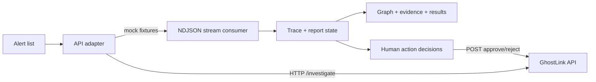

# GhostLink frontend

React 18 + Vite analyst workspace for the GhostLink v1.0 draft contract. It displays synthetic demo data only, does not infer guilt, and never executes account actions automatically. Human approve/reject buttons only decide returned proposals.

## Setup and run

```powershell
cd web
npm install
Copy-Item .env.example .env
npm run dev
```

Mock mode is the default (`VITE_USE_MOCK=true`). Open the Vite local address shown by the command. Mock reports, evidence, scores and statuses are fixed synthetic scenario responses. They are not real threat intelligence.

| Mock scenario | Provisional score | Band |
| --- | ---: | --- |
| `203.0.113.45` ring/conflicting indicators | 71 | `human_review` |
| `198.51.100.77` public Wi-Fi decoy | 0 | `monitor` |
| `192.0.2.88` stale indicator | 0 | `monitor` |
| `192.0.2.150` family-device sharing | 16 | `monitor` |

These are frontend-fixture scores calculated from the fixture's mock signals and listed penalties/caps to exercise the frozen response shape. They are not verified outputs from the backend scoring implementation or calibrated probabilities; confirm the actual scenario scores with the backend owner before using them in a demo as backend results.

## Mock vs backend

`VITE_USE_MOCK=true` uses the deterministic frontend fixtures. For a real backend, set `VITE_USE_MOCK=false` and `VITE_API_BASE_URL` to the backend origin before starting/building. These variables are public build-time frontend configuration; never put secrets here. `npm run build` creates a static `dist/` directory. Deploy only after setting the actual backend origin and configuring backend CORS; no deployment URL is claimed here.

The adapter accepts either the contract `{ "alerts": [...] }` response or an array for alert compatibility. A 404 on `/alerts` falls back to visibly simulated fixtures. Other HTTP/network errors are surfaced. The investigation endpoint is consumed as NDJSON; SSE `data:` lines are tolerated.

### Run against the cloned backend (Windows PowerShell)

Install the root backend dependencies once, then run Uvicorn from the repository root:

```powershell
Set-Location ..\
python -m pip install -r requirements.txt
$env:TOOL_MODE = 'mock'
python -m uvicorn api.main:app --host 127.0.0.1 --port 8000
```

In a second terminal, configure and run the frontend:

```powershell
Set-Location web
@'
VITE_USE_MOCK=false
VITE_API_BASE_URL=http://127.0.0.1:8000
'@ | Set-Content .env
npm run dev -- --host localhost --port 5173
```

Open `http://localhost:5173/`. The browser origin matches the backend's current CORS allow-list. The adapter can display the current backend's synchronous JSON report and trace; it explicitly says that live investigation steps are not streamed. It omits findings whose citations are not valid `EV-...` evidence IDs in the backend's same-run evidence list. The current backend response has evidence IDs but not the full evidence objects, so the evidence panel will not invent their metadata. Its action adapter sends the `decision` body expected by the current backend, even though the frozen contract specifies an empty request body.

The backend's second alert uses `198.51.100.77`, the address present in the generated public-Wi-Fi decoy scenario. During investigation, shared-device findings are retained only when at least two device members were observed on the trigger IP, and transaction cycles only when all cycle accounts were observed on it; this avoids attributing the ring's A2 activity to the public-network decoy. The public-network guardrail also reduces the score.

## Tests

```powershell
npm test
npm run build
```

Tests cover buffered NDJSON/SSE parsing and malformed JSON, the mock stream and rendered report, graph decoy/path transforms, and an action 409. The action endpoint should also be verified against the running backend before integration sign-off.

## Architecture



The graph model and graph schema are documented in [../readme.md](../readme.md#graph-schema). Useful Cypher query examples are in [../readme.md](../readme.md#useful-cypher-queries).

## Demo instructions and video shot list (~3 minutes)

1. **0:00–0:20 — Problem and scope:** Show the workspace title and “Simulated data”; say graph relationships prioritize analyst review and are not proof.
2. **0:20–0:45 — Alerts:** Point to the four documentation-range IPs and select `203.0.113.45`.
3. **0:45–1:15 — Streaming:** Show plan/tool call/tool result steps arriving and identify the mock/demo nature of the evidence.
4. **1:15–1:45 — Ring graph and evidence:** Select the transaction-cycle finding; show highlighted path, EV IDs, tiers, sources and relationships.
5. **1:45–2:10 — Decoy:** Select `198.51.100.77`; show public Wi-Fi/high-degree guardrail and low provisional score. Explain shared networks do not prove fraud.
6. **2:10–2:30 — Stale/conflict:** Open `192.0.2.88` to show stale indicator warning, then `203.0.113.45` for conflicting indicator sources.
7. **2:30–2:50 — Limitations and action:** Read the disclaimer and limitations; approve one and reject another proposal only as explicit human interactions.
8. **2:50–3:00 — FalkorDB role:** Explain the backend graph stores entities, relationships and evidence; the current frontend mock mode does not connect to a live database.

Capture shots: complete alert overview, live trace, graph with selected path, evidence identifiers/details, decoy guardrail, score disclaimer and both decided statuses. Do not imply live threat intelligence or an actual deployment.

## Troubleshooting

- **Alerts fail to load:** In mock mode confirm `VITE_USE_MOCK=true`; in backend mode check `VITE_API_BASE_URL`, backend availability and CORS.
- **Connection lost:** The UI retains partial steps. Retry starts another request; a closed stream without `done` is not treated as success.
- **422:** Check the selected IP/request fields against the backend validator.
- **404/409 on action:** 404 means the action is missing; 409 means it is no longer pending. Reload/re-investigate for current server state.
- **No graph:** Check that the report includes `graph.nodes` and `graph.links`; the UI does not fabricate graph data.

## Known integration mismatches to confirm with Inchara/Mohan

- `/alerts` is a bare array, with no timestamp or source field. The UI displays returned labels and marks missing time as “Time not returned”.
- `/investigate` returns JSON rather than the required NDJSON event stream and report schema. The UI displays the completed trace and explicitly identifies the lack of live streaming.
- The backend report includes some findings citing `TI-...` indicator IDs instead of the `EV-...` IDs returned by graph tools. The adapter omits those unsupported citations and records the omission in limitations.
- The backend report includes an evidence ID list, but not evidence objects with tier, reliability, source and relationship. The evidence view reports those details as unavailable rather than filling them in.
- Backend action endpoints currently require a `{ "decision": "approve"|"reject" }` body and return a different response shape. The adapter sends the required body and maps the returned `action_id`; this is a compatibility shim, not a change to the frozen contract.
- Backend action responses and case IDs differ from the frozen contract field/enumeration formats. Confirm and align those with the backend owner before contract-level integration sign-off.

## Synthetic-data disclosures and limitations

- Every alert, account, IP relationship, transaction, evidence item and indicator shown in mock mode is synthetic and uses documentation-only IP ranges.
- Scores are deterministic provisional prioritisation aids, not probabilities of guilt.
- Shared IPs/devices or location are not proof; indicators can be stale or conflicting.
- Proposals require a human decision. No account is automatically deactivated, blocked, or suspended.
- Indicator notes and other source text are rendered as escaped plain text, never interpreted as markup or instructions.
- Public deployment, backend integration, CORS verification, and private-window checks have not been performed.
